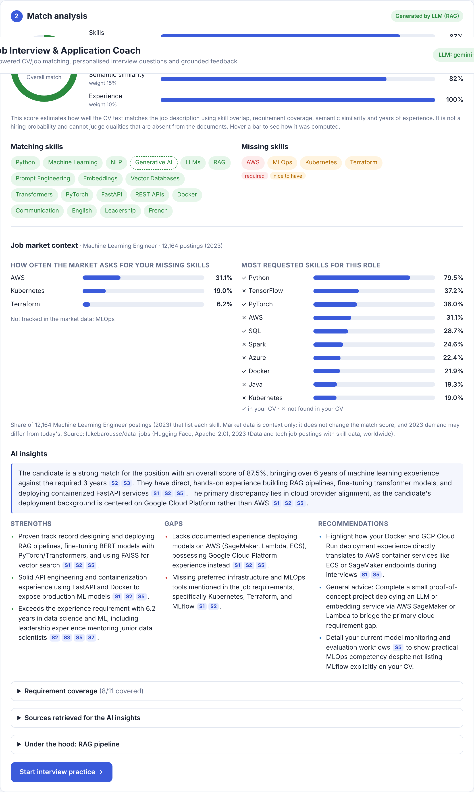
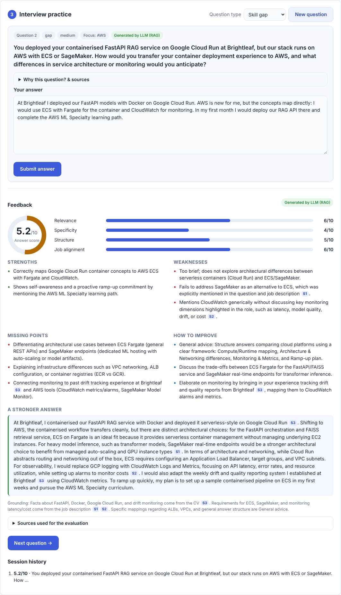
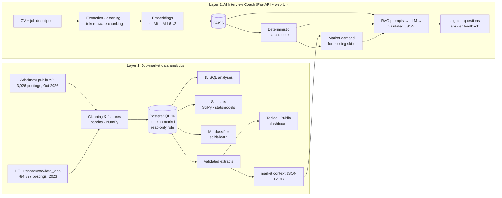
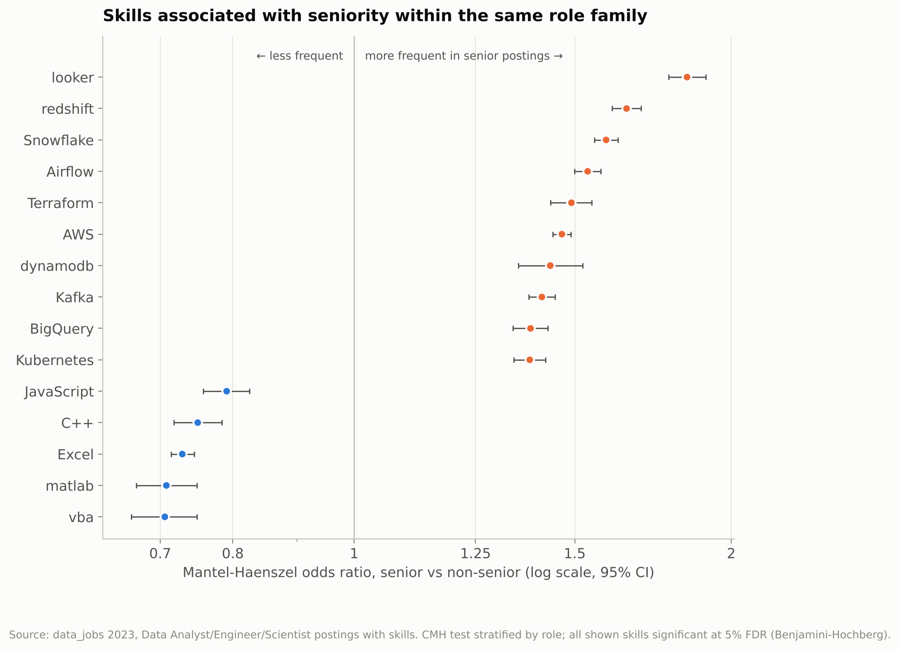
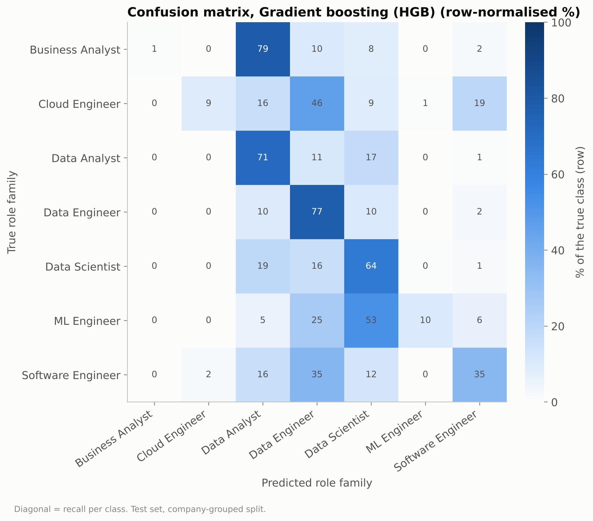
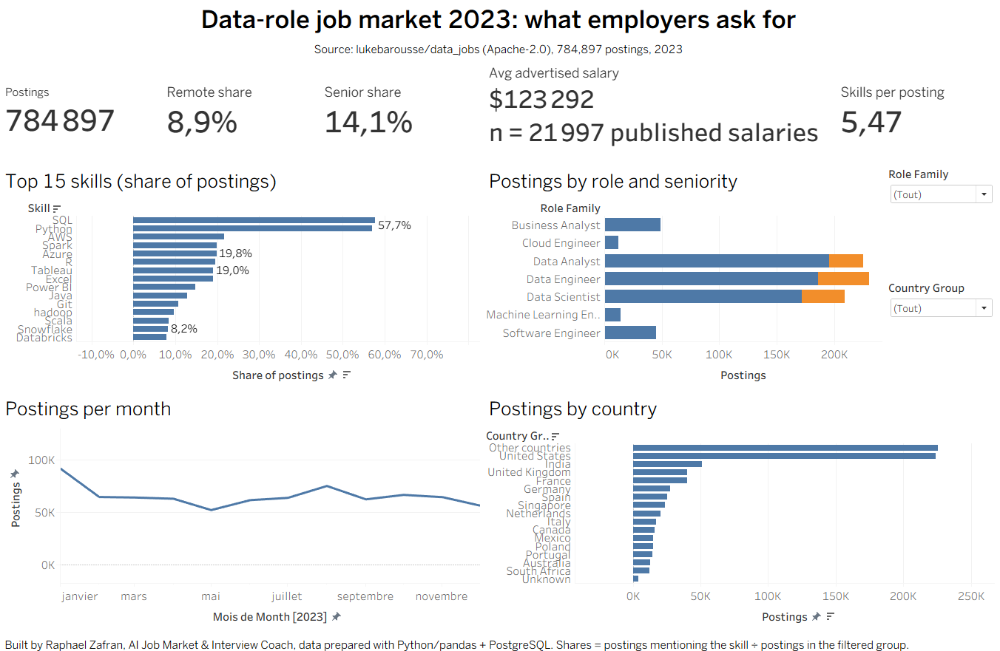
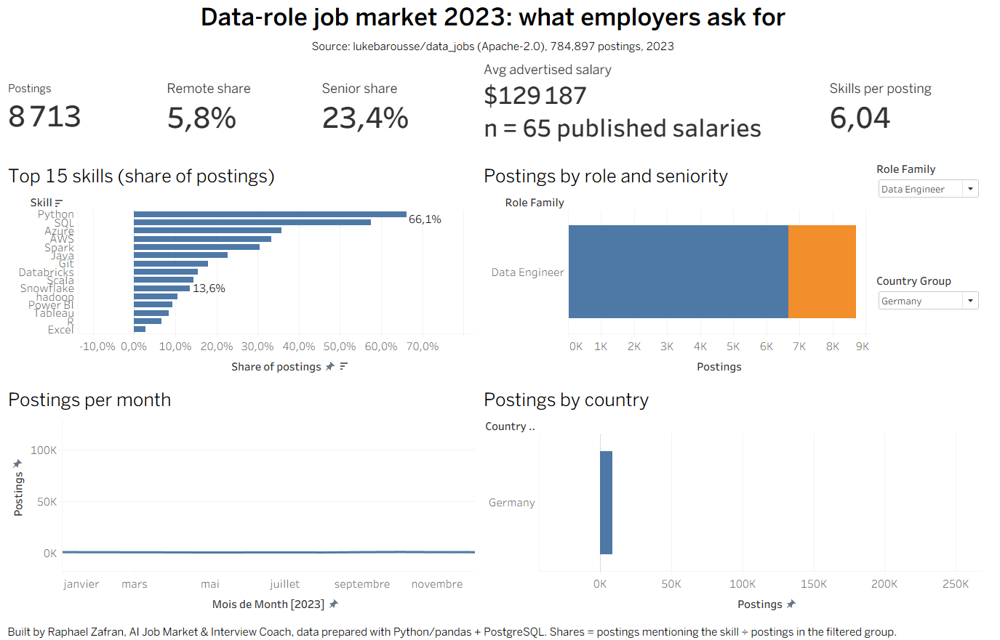
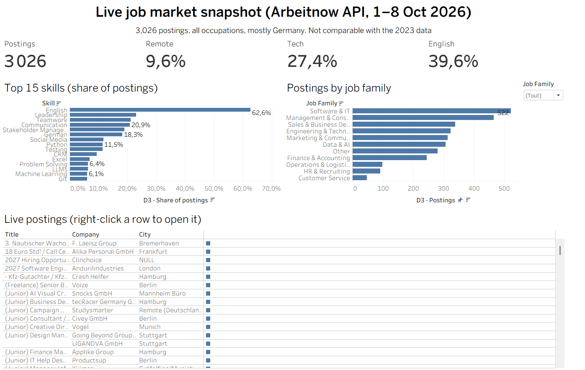
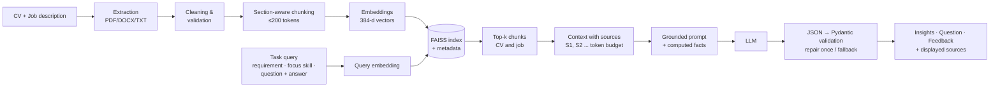
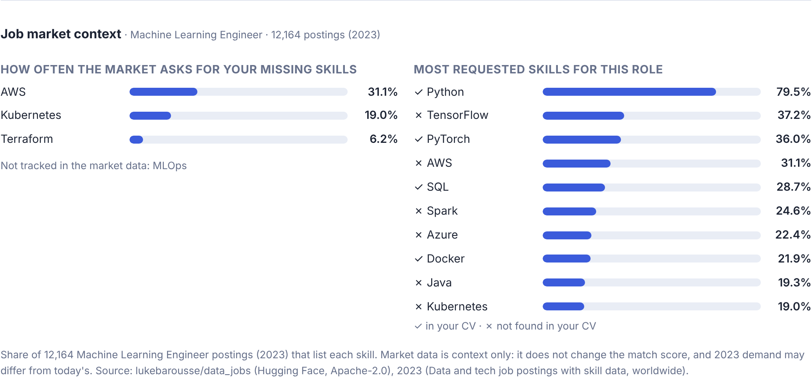

# AI Job Market & Interview Coach

> From job-market data to personalised interview preparation. A data-analytics pipeline measures what employers ask for (Python, PostgreSQL, statistics, machine learning, Tableau). A RAG application then compares a candidate's CV with a specific job, explains the match, shows how much the market asks for the missing skills, and coaches the candidate through interview questions with grounded feedback.

Final project, Data Science & Generative AI Bootcamp.

**Live app:** <https://ai-job-interview-coach-291756431151.europe-west1.run.app/> · **Dashboard:** [Tableau Public](https://public.tableau.com/app/profile/raphael.zafran/viz/AIJobMarketInterviewCoachMarketDashboards/D1-Overview)

| Match analysis with market context | Interview practice & feedback |
|---|---|
|  |  |

*Screenshots taken on the live app (Google Cloud Run, 2026-10-15) with the fictional sample documents and Gemini (`gemini-flash-latest`) as LLM.*

---

## Table of contents

1. [Problem](#problem)
2. [Solution](#solution)
3. [Architecture](#architecture)
4. [Layer 1: Job-market data analytics](#layer-1-job-market-data-analytics)
5. [Layer 2: AI Interview Coach](#layer-2-ai-interview-coach)
6. [How the two layers connect](#how-the-two-layers-connect)
7. [Technology Stack](#technology-stack)
8. [Project Structure](#project-structure)
9. [Installation](#installation)
10. [Running the Coach](#running-the-coach)
11. [Reproducing the Data Pipeline](#reproducing-the-data-pipeline)
12. [Environment Variables](#environment-variables)
13. [API Documentation](#api-documentation)
14. [Testing](#testing)
15. [Evaluation](#evaluation)
16. [Challenges](#challenges)
17. [Limitations and Ethics](#limitations-and-ethics)
18. [Future Improvements](#future-improvements)
19. [Demo](#demo)

---

## Problem

Job seekers usually prepare for interviews with generic question lists and guesswork. They do not know:

- **what the market actually asks for** in their target role (which skills, how often, at which seniority);
- **how well their CV matches a given job** and *why*;
- **which requirements their CV does not evidence**, which are exactly the topics an interviewer will dig into;
- whether their answers are specific, structured and connected to the role.

Generic LLM chats make this worse in a subtle way: they confidently invent experience the candidate never had, or produce a "match percentage" that cannot be explained.

## Solution

Two layers, one story: **"What does the market want?" → "How does my CV compare, and how do I prepare?"**

| Need | How it is solved |
|---|---|
| "What do employers ask for?" | Data pipeline over **787,923 job postings** (two public sources), PostgreSQL, 15 SQL analyses, statistical tests and an interactive **Tableau Public** dashboard. |
| "Which skills define a role?" | A **scikit-learn classifier** predicts the role family from a posting's skills (macro-F1 0.393 vs 0.142 for a stratified baseline); permutation importance shows which skills drive each role. |
| "How well do I match this job?" | Deterministic, documented **match score** combining 4 signals; every sub-score is explained in the UI. |
| "Does the market care about my gaps?" | The coach shows, for each **missing skill**, the share of postings of that role family that ask for it. Example: AWS appears in 31.1 % of 12,164 Machine Learning Engineer postings. |
| "What will they ask me?" | RAG (FAISS retrieval over the CV and job) + LLM generates **personalised interview questions**, with sources. |
| "Was my answer good?" | The answer is evaluated against a 4-criterion rubric and the retrieved context, and a stronger answer is proposed (with `[placeholders]` instead of invented facts). |
| "Can I trust it?" | Sources (`[S1]`, `[S2]`...) are displayed; outputs are validated JSON; every number comes from saved, reproducible results; limitations are stated. |

## Architecture



**Design principles:**
- **Every technology has a job.** PostgreSQL stores 4.5 M rows and enforces least privilege. Statistics test hypotheses with effect sizes. ML quantifies how much skills say about a role. The dashboard explores the market. RAG grounds the LLM in the candidate's own documents.
- **Deterministic where possible, LLM where useful.** Scores, skills, statistics and market figures are computed in code and reproducible. The LLM writes language: explanations, questions and feedback.
- **No fabricated numbers.** Every figure in this README and the docs comes from a saved result file: `data/processed/*_results/`, `evaluation/results_*.md`, `dashboard/tableau/data/validation.json`.

---

## Layer 1: Job-market data analytics

Detailed documentation per phase: [Data pipeline](docs/DATA_PIPELINE.md) · [Database](docs/DATABASE.md) · [Statistics](docs/STATISTICAL_ANALYSIS.md) · [Machine learning](docs/MACHINE_LEARNING.md) · [Dashboard](docs/DASHBOARD.md).

### Data sources

| | Live snapshot | Reference dataset |
|---|---|---|
| Source | [Arbeitnow](https://www.arbeitnow.com/) public job-board API (JSON) | [`lukebarousse/data_jobs`](https://huggingface.co/datasets/lukebarousse/data_jobs) on Hugging Face |
| Licence / terms | Public API, attribution link kept per posting; no scraping | Apache-2.0 |
| Period | Snapshot of 2026-10-08 | Postings from 2023 |
| Rows | 3,180 fetched → **3,026** after cleaning | 785,741 → **784,897** after cleaning |
| Scope | All occupations, mostly Germany | Data/tech roles, worldwide |
| In Git? | Processed tables yes; raw pages no (they contain recruiter contact details) | No (231 MB): pinned revision, SHA-256 verified on download |

The two sources are **analysed separately and never compared over time**. Their populations differ: data roles worldwide in 2023 vs all occupations in Germany in 2026.

### Pipeline

1. **Ingestion:** polite API pagination with Pydantic validation; reproducible download with checksum.
2. **Cleaning & features:**
   - HTML to text, language detection, de-duplication, country repair;
   - skill extraction with the coach's own 99-skill taxonomy;
   - seniority, remote and role-family features;
   - profiling reports with missing values and duplicates.
3. **PostgreSQL 16:**
   - two fact tables, shared dimensions (`sources`, `companies`, `skills`) and skill link tables;
   - an owner role and a **read-only** `coach_reader` role that cannot see job description text;
   - an idempotent COPY loader whose row counts are checked (4,478,391 rows);
   - 15 analytical queries with saved results.
4. **Statistics** (SciPy, statsmodels): see below.
5. **Machine learning** (scikit-learn): see below.
6. **Dashboard extracts:** 11 CSV files built in SQL. They are dense, with per-row denominators, so every share stays correct under any Tableau filter. 25/25 validation checks pass against the database (counts, shares and the values shared by dashboard filters).

### Statistical results (`data/processed/stats_results/`)

| # | Question | Test | Result |
|---|---|---|---|
| A | Do senior postings list more skills? | Mann-Whitney U per role, Holm correction | Yes, but **small/negligible** effect (Cliff's δ 0.15 / 0.13 / 0.05) |
| B | Is remote work associated with the job family? | Chi-square | **Negligible** (2023, V = 0.081) / **small** (2026, V = 0.147) |
| C | Which skills are over-represented in senior postings, within the same role? | Cochran-Mantel-Haenszel per skill, Benjamini-Hochberg | 64 of 71 skills significant, odds ratios 0.71–1.84 |
| D | What is the advertised salary associated with? | OLS on log(salary), HC3 errors | R² = 0.26; senior **+17.2 %**; ML Engineer **+60.9 %** vs Data Analyst |
| E | Do more experienced profiles list more skills? (live data) | Kruskal-Wallis + Spearman, stratified by language | **Small** effect (ε² = 0.033) |

With up to 785k rows almost every test is "significant". The conclusions therefore rely on **effect sizes and confidence intervals**, and all results are associations, not causal effects. The executed notebook is [`notebooks/statistical_analysis.ipynb`](notebooks/statistical_analysis.ipynb).

### Machine learning (`data/processed/ml_results/`)

**Task:** predict the role family (7 classes) of a 2023 posting from its skills.

**Method:**
- 641,060 postings, 59 features (58 coach-taxonomy skills + skill count);
- **company-grouped** train/test split, so no company appears on both sides;
- grid search with StratifiedGroupKFold;
- HistGradientBoosting selected on cross-validated macro-F1.

| Model (test set, 132,728 postings) | Macro-F1 | Accuracy |
|---|---|---|
| Most-frequent baseline | 0.071 | 0.327 |
| Stratified baseline | 0.142 | n/a |
| **HistGradientBoosting** | **0.393** | **0.639** (top-3: 0.929) |

**Interpretation:**
- Skills alone carry real but limited information about a role: Data Analyst, Data Engineer and Data Scientist overlap heavily.
- A second experiment (senior vs non-senior from skills) reaches only ROC-AUC 0.625. It is reported as a weak, honest negative result.

The executed notebook is [`notebooks/ml_analysis.ipynb`](notebooks/ml_analysis.ipynb).

| Senior skill odds ratios (statistics C) | Role classifier confusion matrix |
|---|---|
|  |  |

### Interactive dashboard (Tableau Public)

**Public link:** <https://public.tableau.com/app/profile/raphael.zafran/viz/AIJobMarketInterviewCoachMarketDashboards/D1-Overview>

- **What it contains:** 2 published dashboards:
  1. *2023 market overview* (784,897 postings): KPI tiles, top 15 skills, postings by role and seniority, by month and by country; filters on role family and country apply to every chart, including the skill chart (a different data source, linked by blend relationships).
  2. *Live 2026 snapshot* (3,026 Arbeitnow postings): KPI tiles, top 15 skills, postings by job family, and the list of postings with a link back to each original ad; filter on job family.
- **Checked against the data:** every number shown was compared with [`EXPECTED_VALUES.md`](dashboard/tableau/EXPECTED_VALUES.md), unfiltered and filtered (e.g. Data Engineer + Germany: 8,713 postings, Python 66.1 %, SQL 57.6 %).
- **Built from:** the data files in `dashboard/tableau/data/` (11 CSV + data dictionary + 25 validation checks), the [build guide](dashboard/TABLEAU_BUILD_GUIDE.md) and the [design specification](docs/DASHBOARD.md). The guide also describes two optional dashboards (skills/seniority/salary and model results) that are not part of the published workbook.

| 2023 overview | Filtered: Data Engineer + Germany | Live 2026 |
|---|---|---|
|  |  |  |

---

## Layer 2: AI Interview Coach

The user uploads (or pastes) a **CV** and a **job description**. The application:

1. extracts and cleans the text (PDF, DOCX, TXT);
2. splits both documents into section-aware, token-bounded **chunks**;
3. turns every chunk into an **embedding** and indexes it with **FAISS**;
4. computes a **transparent match score** (skills, requirement coverage, semantic similarity, experience);
5. adds the **job-market context**: demand for the job's missing skills in the detected role family;
6. uses **semantic retrieval + an LLM** to explain the match, generate **personalised interview questions** and **evaluate answers**, always citing the CV/job passages it relied on.

It is **not** a chatbot that receives the whole CV and job ad in one prompt. Every LLM call receives only the chunks retrieved by FAISS for that specific task, plus deterministic facts computed in code.

### Features

- **Document input:** PDF, DOCX (including tables) and TXT upload, or pasted text. Clear errors for empty, scanned/image-only, corrupted, unsupported or oversized files.
- **Preprocessing:** Unicode normalisation, PDF artefact repair, bullet normalisation, validation. Technical tokens such as `C++`, `C#`, `Node.js` and `5+ years` are preserved.
- **Tokenization and chunking:** chunk sizes are measured with the embedding model's own word-piece tokenizer. Chunks are section-aware, at most 200 tokens, with overlap.
- **Embeddings:** `sentence-transformers/all-MiniLM-L6-v2` (384 dimensions, local CPU, pretrained inference only), with an LRU cache.
- **FAISS vector search:** exact cosine similarity (`IndexFlatIP`), with metadata aligned to every vector.
- **Match analysis:**
  - overall score + 4 sub-scores;
  - matching, missing (required vs nice-to-have) and additional skills;
  - requirement-by-requirement coverage with CV evidence;
  - years of experience.
- **Job-market context:** demand for missing skills and the role's top 10 skills (✓/✗ against the CV), from the analytics layer.
- **AI insights, interview questions (4 categories), answer evaluation (rubric, stronger answer, grounding note).**
- **Provider-agnostic LLM layer:** any OpenAI-compatible API (OpenAI, Gemini, Groq, Ollama...).
- **Offline mode and fallback:** without an API key, or if the LLM fails, the app still works with template- and heuristic-based generation, and it labels those results.
- **Web UI + REST API + OpenAPI docs**, Docker image.

### How the RAG pipeline works



1. **Extraction and cleaning** (`app/document_processing/`):
   - pypdf, python-docx (paragraphs and tables), TXT with encoding fallbacks;
   - magic bytes are checked first, and scanned PDFs are rejected explicitly;
   - cleaning removes formatting noise but never content: no lower-casing or stemming.
2. **Tokenization and chunking:**
   - `all-MiniLM-L6-v2` has a hard **256-token** window, so chunk sizes are measured with the same tokenizer and limited to 200 tokens;
   - chunks never cross sections, and a new job entry starts a new chunk;
   - whole units overlap between consecutive chunks.
3. **Embeddings:**
   - L2-normalised 384-d vectors of `"{section}: {chunk}"`;
   - queries are embedded with the same model;
   - a `HashingEmbedder` exists **only** for tests: it is deterministic but not semantic.
4. **FAISS:**
   - `IndexFlatIP` gives exact search; a session holds only tens of vectors, so approximate indexes would only add recall loss;
   - a Python list keeps each chunk at the same position as its vector.
5. **Retrieval:**
   - multi-query retrieval for insights (one query per requirement, because a whole job ad exceeds the 256-token window);
   - balanced CV + job retrieval for questions and evaluation;
   - chunks below cosine 0.15 are discarded.
6. **Grounded generation:**
   - every prompt starts with the grounding rules: use the context, never invent experience or numbers, cite `[S#]`, prefix general tips with `General advice:`;
   - computed facts (scores, skills, market demand) are given as facts that the model must not change.
7. **Structured outputs:** JSON mode → safe JSON extraction → Pydantic validation (types, enums, 0–10 ranges, lengths) → one repair request with the exact errors → otherwise `LLMError`. The overall answer score is the mean of the rubric criteria, **computed in code**.
8. **Fallback:** if the LLM fails and `LLM_FALLBACK_TO_OFFLINE=true`, the offline generator answers over the same retrieved context, and the result is labelled `offline-fallback`.

### Matching methodology

The overall score is a **weighted average of four deterministic signals**. The LLM never decides the percentage.

| Signal | Weight | Computation | Why this weight |
|---|---|---|---|
| **Skill overlap** | 0.40 | Matched job skills ÷ job skills; nice-to-have skills count ×0.5 | Most explicit and verifiable signal |
| **Requirement coverage** | 0.35 | Per requirement: `max(semantic credit, skill credit)`, averaged | Captures requirements phrased beyond keywords, via FAISS evidence |
| **Semantic similarity** | 0.15 | Cosine between mean CV and mean job vectors, rescaled | Holistic but coarse |
| **Experience** | 0.10 | min(1, CV years ÷ required years) | Crude seniority proxy; a low weight avoids penalising career changers |

**How the score handles edge cases:**
- A signal that cannot be computed (e.g. no stated years) is marked *not applicable*, and the other weights are re-normalised.
- Skills come from a curated taxonomy (99 skills with aliases), with handling of alternatives ("PyTorch **or** TensorFlow") and implications (`PostgreSQL → SQL`).
- Cosine values are rescaled with anchors calibrated on the 3×3 evaluation set.
- **Out-of-domain jobs.** Soft skills (communication, leadership...) count half as much as job-specific skills, both in the skill signal and as evidence for a requirement. The skill signal's weight shrinks when the job lists fewer than 3 weighted skills. Years of experience are credited in proportion to requirement coverage (fully from 70 %).

  These rules were added after an audit found an ML engineer CV scoring 58.8 % against a nurse job, because "Communication" was the only skill the nurse job listed. That pair now scores 19 %. The relevant sample pair moves from 87.5 to 85.4, and the 3×3 ranking is unchanged.

> The score estimates how well the **text** of the CV matches the **text** of the job description. It is not a hiring probability. The UI states this next to the score.

**Example** (sample documents): **85 %** = Skills 87 % × 0.40 + Requirements 81 % × 0.35 + Semantic 82 % × 0.15 + Experience 100 % × 0.10. Missing: AWS (required); MLOps, Kubernetes, Terraform (nice to have).

---

## How the two layers connect

1. **Shared vocabulary.** The data pipeline extracts skills from 787,923 postings with the **coach's own skill taxonomy**, so "AWS" in the market data and "AWS" in a CV are the same concept.
2. **Market context in the coach** (`app/market_context/`). After the match analysis, the coach:
   - detects the job's role family from its title (7 data/tech families);
   - shows how often 2023 postings of that family ask for each **missing skill**;
   - shows the role's top 10 skills, marked ✓/✗ against the CV.

   These figures are also passed to the LLM as labelled facts. The data is a 12 KB JSON file regenerated from the validated Tableau extract (`python -m market.coach_context`; a test checks it is identical). The coach therefore needs **no database** and still works offline.
3. **Honesty rules:**
   - the market context never changes the match score;
   - jobs outside the covered role families (e.g. marketing) get no figures rather than misleading ones;
   - the source and year are always shown.



---

## Technology Stack

| Layer | Technology | Used for |
|---|---|---|
| Language | Python 3.11+ (developed on 3.13; Docker image 3.12) | Everything |
| Data | pandas, NumPy, httpx | Ingestion (API + checksummed download), cleaning, features |
| Database | PostgreSQL 16, psycopg 3 | Storage, SQL analysis, least-privilege roles |
| Statistics | SciPy, statsmodels | Hypothesis tests, effect sizes, OLS |
| Machine learning | scikit-learn, joblib | Role-family classifier |
| Visualisation | matplotlib, Tableau Public | Figures, interactive dashboard |
| Notebooks | Jupyter (nbformat, nbclient) | Executed analysis notebooks |
| API | FastAPI, Uvicorn, Pydantic v2, pydantic-settings | Coach backend, validation, OpenAPI |
| Documents | pypdf, python-docx | CV/job extraction |
| Embeddings | sentence-transformers `all-MiniLM-L6-v2`, HF tokenizer | Semantic vectors, token counts |
| Vector search | FAISS (`faiss-cpu`) | Exact cosine similarity |
| LLM | `openai` SDK, any OpenAI-compatible endpoint (validated with Gemini) | Insights, questions, feedback |
| UI | HTML + CSS + vanilla JavaScript | No build step |
| Quality | pytest | 195 automated tests |
| Packaging | Docker, Docker Compose | Coach image + optional PostgreSQL |

## Project Structure

```
ai-job-interview-coach/
├── app/                          # Layer 2: AI Interview Coach (FastAPI)
│   ├── main.py                   # App factory, error handlers, UI route
│   ├── api/                      # Service wiring + routes (health, documents, analysis, interview)
│   ├── core/                     # Settings, errors, logging, in-memory sessions
│   ├── document_processing/      # Extraction, cleaning, tokenizer, chunker
│   ├── embeddings/               # Embedding providers + cache
│   ├── retrieval/                # FAISS store + retriever
│   ├── matching/                 # Skill taxonomy, requirements, transparent score
│   ├── market_context/           # Market demand for the job's skills (+ 12 KB JSON)
│   ├── rag/                      # Prompts, LLM layer, planner, offline generator, pipeline
│   └── ui/static/                # index.html, styles.css, app.js
├── market/                       # Layer 1: job-market data analytics
│   ├── ingestion/                # Arbeitnow API client, HF dataset download
│   ├── cleaning_*.py, text.py    # Cleaning and feature engineering
│   ├── profiling.py, pipeline.py # Profiling reports, pipeline entry point
│   ├── db/                       # PostgreSQL config, setup, loader, query runner
│   ├── stats/                    # Statistical analyses (SciPy, statsmodels)
│   ├── ml/                       # Features, training, figures (scikit-learn)
│   ├── dashboard/export.py       # Tableau extracts + validation
│   └── coach_context.py          # Builds app/market_context/skill_demand_2023.json
├── sql/                          # Schema, views, security, 15 analyses, dashboard exports
├── notebooks/                    # Executed statistics and ML notebooks
├── data/
│   ├── examples/                 # Fictional sample CV (TXT/PDF/DOCX) + job description
│   ├── raw/                      # Manifests only (raw data is not versioned)
│   └── processed/                # Cleaned live data, reports, SQL/stats/ML results
├── dashboard/                    # Tableau build guide, expected values, data extracts
├── models/role_classifier.joblib # Trained classifier (4 MB)
├── reports/figures/              # Statistics and ML figures
├── evaluation/                   # GenAI evaluation (data, script, results)
├── tests/                        # 195 tests
├── scripts/                      # Sample documents, local PostgreSQL, notebook builders
├── docs/                         # Phase documentation, demo script, screenshots
├── demo_day/                     # Demo Day material
├── Dockerfile, docker-compose.yml
├── requirements.txt, requirements-dev.txt
└── .env.example
```

## Installation

Requirements: Python 3.11+ and about 1.5 GB of disk (PyTorch CPU + embedding model).

```bash
git clone https://github.com/raphzaf/ai-job-interview-coach.git
cd ai-job-interview-coach

python -m venv .venv
source .venv/bin/activate            # Windows: .venv\Scripts\activate

# Recommended: CPU-only PyTorch (much smaller than the default CUDA build)
pip install torch --index-url https://download.pytorch.org/whl/cpu

pip install -r requirements-dev.txt  # everything (app, data layer, tests)
cp .env.example .env                 # then edit .env (see Environment Variables)
```

The embedding model (about 90 MB) is downloaded from Hugging Face the first time the coach starts, then cached.

## Running the Coach

```bash
uvicorn app.main:app --reload
```

Then open:
- **Web UI:** http://localhost:8000
- **Interactive API docs (Swagger):** http://localhost:8000/docs

The coach needs **neither PostgreSQL nor the raw data**. It ships with its market-context file. Without an LLM key it runs in labelled offline mode, and the top-right badge shows which mode is active.

**With Docker:**

```bash
cp .env.example .env    # add your LLM settings
docker compose up --build
```

`docker compose up` starts the coach only. PostgreSQL is an optional service in the `db` profile (see below). The image uses CPU-only PyTorch and includes the embedding model, so the container needs no internet access except to call the LLM API. The image installs the exact package versions verified on 2026-10-12 (`constraints.txt`, torch pinned in the `Dockerfile`), so a later rebuild produces the same environment.

**Deploying online:** the coach runs on Google Cloud Run: <https://ai-job-interview-coach-291756431151.europe-west1.run.app/>. Steps in [`deploy/cloudrun/README.md`](deploy/cloudrun/README.md). The [Hugging Face kit](deploy/huggingface/README.md) still works, but Docker Spaces now require a paid Hugging Face plan.

## Reproducing the Data Pipeline

Every step writes its results to versioned files, so **you do not need to rerun anything to read the results**. To reproduce them:

```bash
# 1. Data (≈ 5 min + a 231 MB download)
python -m market.ingestion.hf_data_jobs     # downloads + verifies the reference CSV
python -m market.ingestion.arbeitnow        # optional: new API snapshot (one is already processed)
python -m market.pipeline                   # cleaning, features, profiling reports

# 2. PostgreSQL 16 (set PG_ADMIN_PASSWORD, COACH_*_PASSWORD and the DATABASE_* URLs in .env)
docker compose up -d db                     # or: scripts/local_postgres.sh start (no Docker)
python -m market.db.setup                   # roles, database, schema, views, privileges
python -m market.db.load                    # ≈ 2–3 min, row counts verified
python -m market.db.run_queries             # 15 analyses → data/processed/sql_results/

# 3. Analysis (read-only role, DATABASE_URL)
python -m market.stats.run_stats            # ≈ 1.5 min → stats_results/ + reports/figures/stats/
python -m market.ml.train                   # ≈ 12 min → ml_results/ + models/role_classifier.joblib
python -m market.ml.figures                 # → reports/figures/ml/
python scripts/build_stats_notebook.py      # re-executes notebooks/statistical_analysis.ipynb
python scripts/build_ml_notebook.py         # re-executes notebooks/ml_analysis.ipynb

# 4. Dashboard and coach
python -m market.dashboard.export           # Tableau CSVs + 25 validation checks
python -m market.coach_context              # coach market-context JSON
```

**Note:** the database scripts read `DATABASE_URL`, `DATABASE_OWNER_URL` and `DATABASE_ADMIN_URL`. If your shell already defines a `DATABASE_URL` for another project, override it.

## Environment Variables

All configuration lives in `.env`, which is never committed (see `.env.example`).

| Variable | Default | Description |
|---|---|---|
| `LLM_PROVIDER` | `openai_compatible` | `openai_compatible` or `offline` (no LLM) |
| `LLM_MODEL` | `gpt-4o-mini` | Model name for the provider |
| `LLM_API_KEY` | *(empty)* | API key. If empty (and not a local server), the coach runs in offline mode |
| `LLM_BASE_URL` | *(empty = OpenAI)* | OpenAI-compatible endpoint URL |
| `LLM_TEMPERATURE` / `LLM_TIMEOUT_SECONDS` | `0.3` / `30` | Generation settings. The timeout bounds each LLM call (connection: 5 s); with one SDK retry, an unreachable provider falls back to offline mode in about 10 s, a hanging one in about 60 s |
| `LLM_FALLBACK_TO_OFFLINE` | `true` | Use the offline generator (labelled) when the LLM fails |
| `EMBEDDING_PROVIDER` / `EMBEDDING_MODEL` | `sentence_transformers` / `all-MiniLM-L6-v2` | `hashing` is for tests only |
| `CHUNK_MAX_TOKENS` / `CHUNK_OVERLAP_TOKENS` | `200` / `30` | Chunking (must stay below the 256-token model limit) |
| `RETRIEVAL_TOP_K` | `4` | Default top-k |
| `MATCH_WEIGHT_*` | `0.40 / 0.35 / 0.15 / 0.10` | Score weights |
| `MARKET_CONTEXT_ENABLED` | `true` | Show job-market demand in the analysis |
| `LOG_LEVEL`, `MAX_UPLOAD_MB` | `INFO`, `5` | Misc |
| `PG_ADMIN_PASSWORD`, `COACH_OWNER_PASSWORD`, `COACH_READER_PASSWORD` | *(empty)* | Data layer only: PostgreSQL passwords |
| `DATABASE_ADMIN_URL`, `DATABASE_OWNER_URL`, `DATABASE_URL` | see `.env.example` | Data layer only: admin, owner and read-only connections |

LLM provider examples:

```bash
# Google Gemini (free tier available): the configuration used to validate the project
LLM_MODEL=gemini-flash-latest
LLM_BASE_URL=https://generativelanguage.googleapis.com/v1beta/openai/
LLM_API_KEY=...

# OpenAI
LLM_MODEL=gpt-4o-mini
LLM_API_KEY=...

# Local Ollama (no key needed)
LLM_MODEL=llama3.1
LLM_BASE_URL=http://localhost:11434/v1

# No LLM at all
LLM_PROVIDER=offline
```

## API Documentation

All endpoints return JSON. Errors have the form `{"error": "<code>", "message": "<human-readable message>"}`.

| Method | Path | Purpose |
|---|---|---|
| `GET` | `/api/health` | Status, LLM provider/model, embedding model, active sessions |
| `POST` | `/api/documents/extract` | Multipart file upload (PDF/DOCX/TXT) → cleaned text |
| `GET` | `/api/documents/samples` | Fictional sample CV and job description |
| `POST` | `/api/analyze` | `{cv_text, job_text, cv_name?, job_name?}` → analysis, market context, `session_id` |
| `POST` | `/api/interview/question` | `{session_id, category?}` → personalised question + sources |
| `POST` | `/api/interview/answer` | `{session_id, question_id, answer}` → structured feedback + sources |

**Error codes:**
- `415 unsupported_format`;
- `422 document_error` / `invalid_request`;
- `404 session_not_found`;
- `502 llm_error` (only if the fallback is disabled);
- `500 internal_error` (generic message; details only in server logs).

Abridged `/api/analyze` response (sample documents):

```json
{
  "match": {"overall_score": 85.4, "missing_skills": [{"name": "AWS", "importance": "required"}, "..."]},
  "market": {
    "available": true, "role_family": "Machine Learning Engineer", "postings": 12164,
    "missing_skill_demand": [{"skill": "AWS", "share": 31.1, "postings_with_skill": 3779, "in_cv": false}, "..."],
    "untracked_missing_skills": ["MLOps"]
  },
  "insights_generated_by": "llm"
}
```

## Testing

```bash
pytest
```

**195 tests, all passing.** They never download a model or call an API: they use a deterministic `HashingEmbedder`, an approximate token counter and a scripted `FakeLLM`. The database tests start a **real temporary PostgreSQL server** when the PostgreSQL binaries are installed, and are skipped otherwise.

| File | Covers |
|---|---|
| `test_document_processing.py`, `test_chunking.py` | Cleaning, technical tokens, PDF/DOCX/TXT, scanned/invalid files, token counting, sections, budgets, overlap |
| `test_embeddings.py`, `test_retrieval.py` | Normalisation, cache, FAISS ordering, metadata, filters, balanced retrieval |
| `test_matching.py` | Skills, aliases, false positives, alternatives, implications, requirements, years, weights, determinism, out-of-domain jobs (nurse, chef), jobs with few skills, incomplete job ads |
| `test_rag.py`, `test_api.py` | JSON extraction/validation/repair, prompts and grounding, planner, full flow with mocked LLM, fallback, HTTP errors |
| `test_market.py` | API pagination, schema checks, checksums, HTML/language/skill parsing, cleaning, profiling, skill shares |
| `test_database.py` | Loader counts, idempotence, rollback, read-only role, constraints, parameterised queries, dense dashboard exports |
| `test_statistics.py` | Each test recovers a planted effect and holds under the null; effect-size labels |
| `test_ml.py` | Shared feature builder, company-grouped split, stratified subsampling, learnable signal |
| `test_market_context.py` | JSON reproducible from the validated extract, figures equal the dashboard's, role detection, no figures outside covered roles, score unchanged, market facts reach the LLM |
| `test_dashboard_files.py` | Shipped Tableau files: fields shared by dashboard filters hold identical values in each source, consistent Remote labels, documented expected values match the files |
| `test_deploy.py` | Hugging Face Space content, Space card validity (port, description length), secret handling (mocked Hub API), every dependency pinned for the Docker build |
| `test_llm_robustness.py` | Provider errors told apart (invalid key reported as HTTP 400, JSON-mode rejection, quota, network, timeout, server), client timeouts, prompt injection in the CV, job ad and answer (wrapped as untrusted data; format changes rejected) |

## Evaluation

```bash
python -m evaluation.run_evaluation --offline   # no API calls
python -m evaluation.run_evaluation             # uses the LLM configured in .env
python -m evaluation.run_evaluation --output results_llm_<date>   # keep earlier result files
```

**Dataset:** 3 fictional CVs × 3 fictional job descriptions (`evaluation/data/`).

**Reports:**
- [`evaluation/results_offline.md`](evaluation/results_offline.md): deterministic parts, current code;
- [`evaluation/results_llm_2026-10-12.md`](evaluation/results_llm_2026-10-12.md): Gemini `gemini-flash-latest`, run after the market context (Phase 8), the scoring fix for out-of-domain jobs and the prompt-injection safeguards, 13 LLM calls;
- [`evaluation/results_llm.md`](evaluation/results_llm.md): the earlier run of 2026-10-08, kept for comparison.

The table shows the 2026-10-12 run, with the 2026-10-08 values in brackets where they differ.

| What | Success criterion | Result |
|---|---|---|
| **Retrieval relevance** (12 labelled queries) | Relevant chunk in top-3 | **hit@1 67 %, hit@3 92 %, MRR 0.81** |
| **Matching consistency** (3×3 matrix + repeat) | Matching pair is best in every row and column; deterministic | **Yes / Yes**: matching pairs average **94.3** vs mismatched **31.8** (95.1 vs 36.8 before the out-of-domain fix) |
| **Structured output validity** | No invalid output reaches the user | **13/13 valid on first try** |
| **Question relevance** (6 questions) | Category respected, personalised, varied | Category 100 %, job reference 83 %, CV reference 83 % (100 %), all unique. The behavioral question references neither by keyword, so it misses both lexical checks |
| **Answer evaluation consistency** | Strong > average > off-topic; small spread | **LLM: 8.0 > 2.65 > 0.1** (8.1 > 2.2 > 0.2), max spread 0.4 points (0.2) |

**Known limitations of this evaluation:**
- a handful of fictional documents;
- labels written by the developer;
- lexical proxies for personalisation;
- one LLM provider tested;
- no human rating.

## Challenges

Problems actually met while building the project:

1. **Raw cosine similarity is not a percentage.** Unrelated texts still score 0.2–0.4 with MiniLM. This led to explicit rescaling anchors, calibrated and documented.
2. **Chunk boundaries.** A job's header was glued to the previous job's bullets. Fixed with the rule "a new entry starts a new chunk".
3. **False skill gaps.** "PyTorch **or** TensorFlow" reported TensorFlow as missing. Fixed with alternative groups and a small implication map.
4. **Skill-share denominators.** A first version computed "share of skill *mentions*" instead of "share of *postings*", which inflated rare skills. It was corrected, and every extract now carries its own denominator so Tableau cannot recompute it wrongly.
5. **A country artefact.** The reference dataset placed 21,775 postings in "Sudan" because of a location-parsing artefact. They were repaired from the location text: 17,629 set to United States, 4,146 set to unknown.
6. **A loader that never finished.** An O(n²) company-id lookup hung for more than 8 minutes. The loader now reads the generated ids back from PostgreSQL and loads 4.5 M rows in 2–3 minutes.
7. **Statistical significance is cheap at 785k rows.** Almost every test rejects H0, so the analysis reports effect sizes and confidence intervals, and calls a negligible effect negligible.
8. **LLM provider drift.** The configured Gemini model was retired mid-project (404). The fallback kept the app working with labelled results, and the configuration moved to `gemini-flash-latest`.

## Limitations and Ethics

**Data:**
- 2023 reference data covers data/tech roles worldwide. The live snapshot is a single week, mostly from Germany.
- Skill detection is English-oriented and limited to the 99-skill taxonomy.
- Salaries are published in only 2.8 % of postings.

**Statistics and ML:**
- All results are associations from observational data, not causal effects.
- The role classifier is moderate (macro-F1 0.393) and the seniority model weak (AUC 0.625). They describe the market; they are not used to judge candidates.

**Coach:**
- The score estimates document fit, not a hiring probability.
- RAG reduces but does not eliminate hallucinations, which is why sources are shown.
- **Prompt injection.** CV, job and answer text are wrapped as untrusted data, and the prompts tell the model never to follow instructions found in them. In one live test, Gemini ignored an injected instruction. This reduces the risk but does not eliminate it.
- **Keyword claims.** Skills are detected from the CV text, so listing a skill counts as having it: adding "AWS, Kubernetes" to a CV raises its score. The score measures what the CV claims, not what the candidate can do.
- The offline mode is a heuristic. There is no OCR. Sessions are in memory. The coach is English only.

**Privacy and licences:**
- CVs are processed in memory and never stored. Only fictional documents are in the repository.
- The coach-only Docker image keeps everything local except the LLM call.
- Only public, licensed data is used (Apache-2.0, plus a public API with attribution links). Raw pages containing recruiter contact details are not versioned.

## Future Improvements

- Use the trained classifier to suggest a role family when the job title is ambiguous.
- Refresh the live snapshot on a schedule and add a time dimension (only once several comparable snapshots exist).
- Hybrid retrieval (BM25 + embeddings) and a re-ranker; a multilingual embedding model.
- A larger taxonomy (ESCO / O*NET).
- Adaptive interview difficulty and persistent progress tracking.
- A larger, human-rated evaluation set.

## Demo

The demo flow, timing and rehearsal checklist are in [`demo_day/DEMO_SCRIPT.md`](demo_day/DEMO_SCRIPT.md).

**Short version:**
1. Dashboard: Data Engineer → Germany → AWS.
2. Coach: **Load sample documents** → **Analyze match**.
3. Show the score, the missing AWS, and **31.1 % of ML Engineer postings ask for AWS**.
4. Generate a skill-gap question, answer it, and show the feedback.
