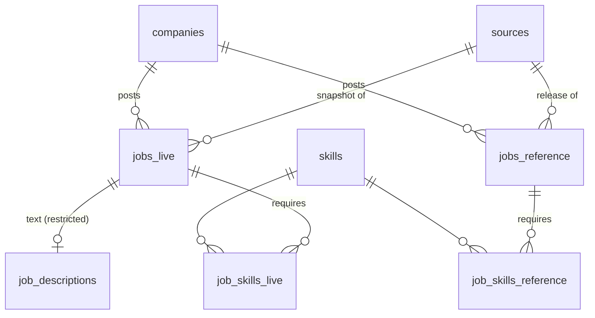

# PostgreSQL + SQL (Phase 3)

**Status: implemented and verified.**
- PostgreSQL 16 holds both job-market sources.
- Two roles apply least privilege: an owner and a read-only reader.
- An idempotent loader checks its row counts against the Phase-2 reports.
- 15 analytical queries are saved with their results.
- 8 integration tests run against a real temporary PostgreSQL server.

Every number in this document comes from `data/processed/sql_results/*.csv`, produced by `python -m market.db.run_queries` on 2026-10-12.

## 1. Quick start

```bash
# 1. A PostgreSQL 16 server, either one of:
docker compose up -d db                                  # needs PG_ADMIN_PASSWORD in .env
PG_ADMIN_PASSWORD=... PGPORT=5432 scripts/local_postgres.sh start   # local binaries, no Docker

# 2. Roles, database, schema, views, privileges (DATABASE_ADMIN_URL, COACH_*_PASSWORD)
python -m market.db.setup

# 3. Load the Phase-2 processed tables (DATABASE_OWNER_URL), ≈ 2–3 min
python -m market.db.load

# 4. Run the analytical queries as the read-only role (DATABASE_URL)
python -m market.db.run_queries
```

All connection strings and passwords come from environment variables (`.env`, see `.env.example`). Nothing secret is stored in the repository.

**Verified on two servers:**
- the local cluster: PostgreSQL 16.15, C collation;
- `docker compose up db`: the `postgres:16` image, `en_US.utf8` collation.

On both, the loader produced the same row counts and the 15 query results were **byte-identical**.

## 2. Schema



| Table | Rows | Content |
|---|---|---|
| `sources` | 2 | Source metadata: URL, license, version (snapshot id / dataset commit), raw and clean row counts |
| `companies` | 141,105 | Employer names shared by both sources (identity key) |
| `skills` | 275 | Shared skill vocabulary: category, whether it belongs to the coach taxonomy |
| `jobs_live` | 3,026 | Arbeitnow API snapshot (Oct 2026), features only, `tags`/`job_types_raw` as `text[]` |
| `job_skills_live` | 11,107 | Posting ↔ skill (many-to-many) |
| `job_descriptions` | 3,026 | Cleaned description text: **restricted** |
| `jobs_reference` | 784,897 | `lukebarousse/data_jobs` 2023, cleaned |
| `job_skills_reference` | 3,535,853 | Posting ↔ skill, with source skill type and raw name |

DDL: [`sql/schema.sql`](../sql/schema.sql). Views: [`sql/views.sql`](../sql/views.sql). Privileges: [`sql/security.sql`](../sql/security.sql).

**Design decisions:**

- **One fact table per source.**
  - The two sources are different populations: all occupations in a 2026 snapshot vs data roles worldwide in 2023.
  - Separate tables make an accidental pooled `COUNT(*)` impossible.
  - Every view and query computes shares within one source.
- **Integrity in the database, not only in Python.** Constraints reject invalid data at load time:
  - primary/foreign keys;
  - `CHECK`s on controlled vocabularies (`experience_level`, `schedule`, `seniority_from_title`…);
  - non-negative counts;
  - `clean_rows ≤ raw_rows`;
  - "skill counts are NULL exactly when skills were not extracted" (`CHECK (skills_missing = (skill_count IS NULL))`).
- **Missing stays missing.** Unknown skill lists are `NULL`, not 0; unpublished salaries are `NULL`.
- **Surrogate keys are generated by PostgreSQL** (`GENERATED ALWAYS AS IDENTITY`). The loader reads them back rather than assuming an order. A first version assumed ids followed name order and verified it with a correlated subquery; that check was O(n²) on 141k companies and still running after 8 minutes, and the assumption would also break under another collation. It was replaced.
- **Indexes** match the access paths: `job_skills_*(skill_id)`, `jobs_reference(role_family, is_senior)`, `jobs_reference(country)`, `jobs_live(job_family, experience_level)`. The primary keys cover `job_id` lookups.

## 3. Security and user management

| Role | Privileges | Used by |
|---|---|---|
| `postgres` (admin) | Superuser | `market.db.setup` only |
| `coach_owner` | Owns database `job_market` and schema `market`; DDL + `COPY` loading | `market.db.load` |
| `coach_reader` | `CONNECT`, `USAGE` on `market`, `SELECT` on all tables and views **except `job_descriptions`**. Role defaults: `default_transaction_read_only = on`, `statement_timeout = 60s` | Analyses, notebooks, dashboard exports, the coach app (Phase 8) |

Further hardening:
- `REVOKE ALL ON DATABASE job_market FROM PUBLIC`;
- `REVOKE CREATE ON SCHEMA public FROM PUBLIC`;
- `scram-sha-256` password authentication;
- the Docker port is bound to `127.0.0.1` only.

Passwords are injected into `CREATE ROLE` with `psycopg.sql.Literal` (DDL cannot take bind parameters) and read from environment variables.

All application queries use **bind parameters**. For example, `market/db/queries.py::skill_demand` uses `%(skills)s` and `%(role)s` with `= ANY(...)`. A test passes `x'); DROP TABLE market.skills; --` as a skill name and checks that it is treated as an unknown skill.

Tested (`tests/test_database.py`):
- the reader can read the views but gets *permission denied* on `job_descriptions`;
- the reader cannot `DELETE`;
- the owner can read the descriptions.

## 4. Loading (`market/db/load.py`)

- **One transaction:** `TRUNCATE … RESTART IDENTITY` → COPY dimensions → read back the generated keys → COPY facts → compare row counts with the Phase-2 reports → `ANALYZE` → commit.
- **Failure behaviour:** any error or count mismatch rolls back, so the previous content stays intact (tested).
- **Bulk path:** `COPY … FROM STDIN (FORMAT csv)` in 200k-row chunks. Rows with array columns (`jobs_live`) go through `copy.write_row` so Python lists become `text[]`.
- **Type safety:** pandas float columns holding integers with NaN are converted to nullable `Int64`, because COPY rejects `5.0` for `smallint`.
- **Measured:** 120 s on the local cluster and 173 s on the Docker Compose database, for 4.48 million rows in total (4,478,391). Re-running the load produces identical counts (idempotent, tested).

## 5. Analytical queries ([`sql/analysis_queries.sql`](../sql/analysis_queries.sql))

| # | Question | SQL features |
|---|---|---|
| 01 | Rows per table (load sanity check) | `UNION ALL`, `COUNT` |
| 02 | Most demanded skills in 2023 data postings | `JOIN`, `GROUP BY`, scalar subquery denominator, `ORDER BY`/`LIMIT` |
| 03 | Top-5 skills per role family | CTEs, `RANK() OVER (PARTITION BY …)` |
| 04 | Skills over-represented in senior postings | CTEs, `FILTER`, `HAVING` (min support), `CROSS JOIN`, `NULLIF` |
| 05 | Median salary by role and seniority | `PERCENTILE_CONT … WITHIN GROUP`, `WHERE … IS NOT NULL`, `HAVING COUNT(*) >= 30` |
| 06 | Remote share by role family | Boolean aggregation |
| 07 | Skill counts by seniority (descriptive) | `AVG`, `STDDEV_SAMP`, median |
| 08 | Postings per month (within 2023 source) | Date bucketing |
| 09 | Live snapshot per job family | View `v_live_family_summary` |
| 10 | Skills in tech vs non-tech live postings | Conditional aggregation, scalar subqueries |
| 11 | Profile by employer-stated experience level | `CASE` ordering, aggregates |
| 12 | Cities with ≥ 20 postings | `WHERE`, `GROUP BY`, `HAVING` |
| 13 | Employers posting more than the average employer | `HAVING` with nested-aggregate subquery |
| 14 | Tech postings asking for cloud/DevOps and AI/ML | `FILTER`, `IN (subquery)` |
| 15 | Data-quality checks | `NOT EXISTS`, correlated subquery, `UNION ALL` |

### Selected results (computed)

**02: Top skills, 2023 data postings** (denominator: the 667,989 postings with skill data):

| Skill | Postings | Share |
|---|---|---|
| SQL | 385,638 | 57.73 % |
| Python | 380,495 | 56.96 % |
| AWS | 145,229 | 21.74 % |
| Spark | 132,756 | 19.87 % |
| Azure | 132,400 | 19.82 % |
| R | 130,749 | 19.57 % |
| Tableau | 127,101 | 19.03 % |
| Excel | 126,894 | 19.00 % |

**03: #1 skill per role family:**

| Role family | #1 skill | Share of the role's postings |
|---|---|---|
| Machine Learning Engineer | Python | 79.5 % (TensorFlow 37.2 %, PyTorch 36.0 %, AWS 31.1 %) |
| Data Scientist | Python | 78.5 % |
| Data Engineer | SQL | 67.5 % (Python 64.9 %, AWS 38.6 %) |
| Data Analyst | SQL | 59.9 % (Excel 40.8 %) |
| Business Analyst | SQL | 47.4 % |
| Software Engineer | Python | 40.5 % |
| Cloud Engineer | Python | 34.7 % (AWS 34.3 %) |

**04: Skills relatively more frequent in senior postings** (lift = senior share ÷ non-senior share; skills with ≥ 5,000 postings):

| Skill | Senior share | Non-senior share | Lift |
|---|---|---|---|
| Redshift | 8.53 % | 4.38 % | 1.95 |
| Looker | 4.84 % | 2.67 % | 1.81 |
| Snowflake | 13.16 % | 7.37 % | 1.79 |
| Airflow | 10.84 % | 6.06 % | 1.79 |
| Kafka | 10.94 % | 6.87 % | 1.59 |
| Spark | 27.90 % | 18.48 % | 1.51 |
| AWS | 29.32 % | 20.43 % | 1.44 |

This is descriptive association only. Significance testing is Phase 4.

**05: Median advertised annual salary** (only postings that publish a salary; groups with ≥ 30 salaries):

| Role family | Seniority | n | Median | P25–P75 |
|---|---|---|---|---|
| Data Scientist | Non-senior | 5,921 | 127,500 | 100,000–158,938 |
| Data Scientist | Senior | 1,690 | 155,500 | 125,000–174,000 |
| Data Engineer | Non-senior | 4,500 | 125,000 | 100,000–147,500 |
| Data Engineer | Senior | 1,591 | 147,500 | 125,000–167,174 |
| Data Analyst | Non-senior | 5,446 | 90,000 | 70,000–111,175 |
| Data Analyst | Senior | 1,131 | 111,175 | 92,500–125,000 |

Salaries are as published in the source (mostly US postings) and cover 2.8 % of postings, so they are not representative of all postings.

**06: Remote share by role (2023):** Data Engineer 12.03 % · ML Engineer 10.58 % · Data Scientist 8.77 % · Data Analyst 6.96 % · Software Engineer 6.53 % · Business Analyst 5.69 % · Cloud Engineer 4.63 %.

**07: Mean skills listed, senior vs non-senior:**

| Role family | Non-senior | Senior |
|---|---|---|
| Data Analyst | 3.99 | 4.70 |
| Data Engineer | 6.70 | 7.55 |
| Data Scientist | 5.48 | 5.74 |

The Phase 4 hypothesis test will check whether these differences are statistically significant and practically relevant.

**09/10: Live snapshot (Arbeitnow, Oct 2026):**
- **Median skills per posting:** Data & AI 7 · Software & IT 4 · Finance & Accounting 1.
- **Remote share:** highest in Marketing & Communication (20.13 %), lowest in Finance & Accounting (4.51 %).
- **Skill gaps between tech and non-tech postings:**

| Skill | Tech postings | Non-tech postings |
|---|---|---|
| Python | 28.14 % | 5.19 % |
| CI/CD | 19.08 % | 1.05 % |
| AWS | 14.01 % | 1.50 % |

**14:** Of the 828 live tech postings:
- 336 ask for cloud/DevOps skills;
- 230 ask for AI/ML skills;
- 106 ask for both;
- 135 mention LLMs, RAG or generative AI.

**15: Data-quality checks:**
- 21,775 reference rows with a repaired country;
- 116,908 with unknown skills;
- **0** postings marked as having skills but without `job_skills` rows;
- 65 probable re-posts flagged;
- **0** live postings whose `skill_count` disagrees with their `job_skills` rows.

**Data-quality notes found while querying** (documented, not silently fixed):
- The live location "Remote" (68 postings) carries the API's `remote = true` flag in only 77.94 % of cases.
- Some locations combine two places (e.g. "Gräfelfing/Munich") and are kept as written.

## 6. Tests (`tests/test_database.py`, real PostgreSQL)

A temporary cluster is created with `initdb` on a free port, and the real `setup` and `load` code run on a small synthetic dataset. Tests:
- row counts match the input files;
- loading twice gives identical results (idempotence);
- a count mismatch rolls back and the old data survives;
- the reader is read-only and cannot read `job_descriptions`;
- `CHECK` and foreign-key violations are rejected;
- the country repair and the NULL skill counts survive loading;
- the parameterised `skill_demand` returns per-source shares and treats a hostile skill name as data;
- all 15 analytical queries execute and the data-quality checks return 0 inconsistencies.

The tests are skipped automatically when PostgreSQL server binaries are not installed.
