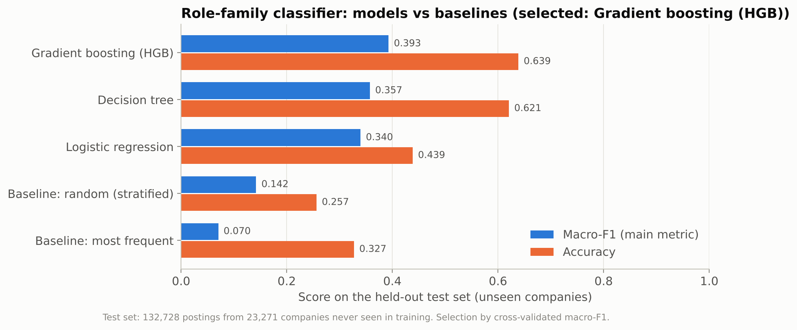
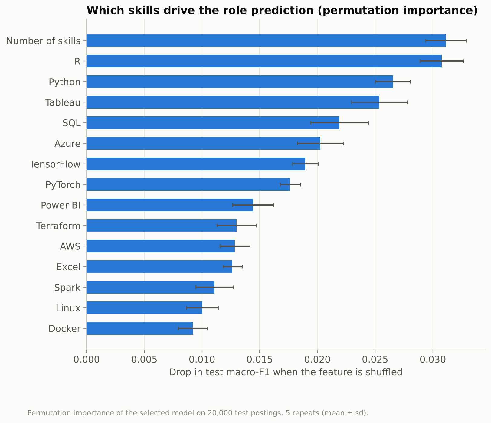
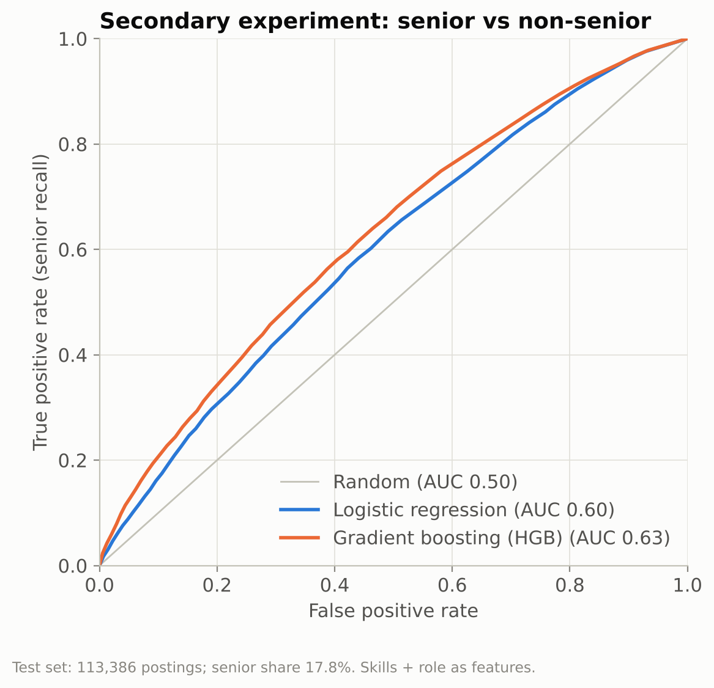

# Machine Learning (Phase 6)

**How it was produced:**
- **Code:** `market/ml/`, scikit-learn.
- **Training:** `python -m market.ml.train`, about 12 minutes on 4 CPU cores. Data is read from PostgreSQL with the read-only role.
- **Saved outputs:** results in `data/processed/ml_results/*.json`, figures in `reports/figures/ml/` (each with a CSV table), model in `models/role_classifier.joblib`.
- **Notebook:** the executed notebook is [`notebooks/ml_analysis.ipynb`](../notebooks/ml_analysis.ipynb).

## 1. Problem

| | |
|---|---|
| **What is predicted** | The **role family** of a data-job posting (7 classes: Data Analyst, Data Engineer, Data Scientist, Business Analyst, Software Engineer, Machine Learning Engineer, Cloud Engineer) from its **skill profile** |
| **Why** | It turns the market data into a tool for the interview coach: "your CV's skill profile looks like a *Data Engineer* posting" positions a candidate against 641k real postings. It also shows which skills separate roles |
| **Secondary experiment** | Senior vs non-senior from skills (+ role). Phase 4 showed the skill differences are small; reported honestly as a weak-signal experiment |
| **Not done** | Salary prediction: only 2.8 % of postings have a salary; it is analysed statistically in Phase 4 instead |

## 2. Data and features

| | |
|---|---|
| Source | `lukebarousse/data_jobs` 2023 (Apache-2.0), PostgreSQL tables `jobs_reference` + `job_skills_reference` |
| Rows | **641,060** postings: those with extracted skills that contain at least one feature skill (26,929 postings without any taxonomy skill excluded) |
| Features (59) | One 0/1 column for each of the **58 skills of the interview coach's taxonomy** + the number of these skills (`n_skills`) |
| Target | `role_family` (`job_title_short` without "Senior ") |
| Excluded on purpose | **Job titles**: the label was produced from titles by the dataset author's classifier, so title words would leak the answer. Country, remote and schedule are excluded because a CV has no such fields |

**Why only taxonomy skills (train/serve consistency).** The coach extracts skills from a CV with its own taxonomy. If the model learned from skills the coach cannot detect (e.g. `hadoop`, `sas`), those features would always be 0 on CVs, and predictions would silently degrade. Training and inference share one function, `build_features()`. The 58 taxonomy skills cover 79 % of all skill mentions in the dataset.

**Preprocessing.**
- Features are already numeric (binary + one count).
- Logistic regression uses `StandardScaler` inside a `Pipeline`, so scaling is learned on training folds only.
- The tree models need no scaling.
- No missing values: postings without skill data are excluded upstream, because a missing list is unknown, not "no skills".

## 3. Methodology

```
641,060 postings
  └─ GroupShuffleSplit by company (80/20, seed 42)
       ├─ train: 508,332 postings, 93,083 companies
       │    ├─ stratified subsample of 120,000 → GridSearchCV, StratifiedGroupKFold (3 folds, grouped by company), scoring = macro-F1
       │    └─ best configuration of each model refit on the full training set
       └─ test: 132,728 postings, 23,271 companies (none seen in training) → evaluated ONCE, all candidates reported
```

- **Company-grouped split.** Large employers post many near-identical, templated ads; the largest company has 5,224 postings. With a random split, the model would be tested on copies of training rows. Grouping by company measures generalisation to **unseen employers**. No company appears in both sets (asserted in code, tested).
- **Macro-F1 as main metric.** Classes are imbalanced: in the test set, Data Engineer is 32.7 % and Cloud Engineer 1.2 %. Accuracy would reward ignoring small classes; macro-F1 weights every role equally.
- **Model selection on cross-validation only.** The test set is not used to choose models or hyper-parameters.
- **Tuning on a subsample.** CV grid search on 120,000 training rows is a compute-budget decision; the selected configurations are then refit on all 508,332 training rows.

### Baselines and candidates

| Model | Hyper-parameter grid | Best configuration (CV) | CV macro-F1 (mean ± sd) |
|---|---|---|---|
| Dummy, most frequent | n/a | n/a | n/a |
| Dummy, stratified random | n/a | n/a | n/a |
| Logistic regression | C ∈ {0.01, 0.1, 1}, class_weight ∈ {None, balanced} | C = 0.01, balanced | 0.353 ± 0.005 |
| Decision tree | max_depth ∈ {8, 14, 20}, min_samples_leaf ∈ {20, 100}, class_weight ∈ {None, balanced} | depth 20, leaf 20, no weighting | 0.344 ± 0.002 |
| **Histogram gradient boosting** | learning_rate ∈ {0.1, 0.2}, max_leaf_nodes ∈ {31, 63}, class_weight ∈ {None, balanced} | **lr 0.1, 63 leaves, no weighting, 200 iterations** | **0.388 ± 0.003** |

Selected: **HistGradientBoostingClassifier**, which has the highest cross-validated macro-F1.

### Overfitting, loss function and regularization

- **Loss functions:** logistic regression and histogram gradient boosting both minimise the multinomial cross-entropy (log loss), the scikit-learn default for these classifiers. The decision tree splits on Gini impurity.
- **Regularization:** logistic regression uses an L2 penalty whose strength C was chosen by cross-validation (C = 0.01, strong regularization). The tree models are limited by depth and minimum leaf size (decision tree) or by the number of leaves, the learning rate and a fixed 200 iterations (gradient boosting).
- **Overfitting checks:** model selection uses cross-validation on the training set only, and the test set contains only companies never seen in training. The selected model's cross-validated macro-F1 (0.388) and its test macro-F1 (0.393) are close, so the choice did not overfit the validation folds.

## 4. Results (test set: 132,728 postings from unseen companies)

| Model | Accuracy | Balanced accuracy | **Macro-F1** | Weighted F1 |
|---|---|---|---|---|
| Baseline: most frequent | 0.327 | 0.143 | 0.070 | 0.162 |
| Baseline: stratified random | 0.257 | 0.142 | 0.142 | 0.258 |
| Logistic regression | 0.439 | **0.469** | 0.340 | 0.477 |
| Decision tree | 0.621 | 0.353 | 0.357 | 0.594 |
| **Gradient boosting (selected)** | **0.639** | 0.381 | **0.393** | **0.614** |

Selected model, top-k accuracy (is the true role among the k most probable?): **top-1 63.9 % · top-2 84.0 % · top-3 92.9 %**.



### Per-class results (selected model)

| Role family | Precision | Recall | F1 | Test support |
|---|---|---|---|---|
| Data Engineer | 0.70 | 0.77 | **0.74** | 43,455 |
| Data Analyst | 0.59 | 0.71 | **0.64** | 35,955 |
| Data Scientist | 0.63 | 0.64 | **0.63** | 36,260 |
| Software Engineer | 0.50 | 0.35 | 0.41 | 6,451 |
| Machine Learning Engineer | 0.47 | 0.10 | 0.17 | 2,264 |
| Cloud Engineer | 0.37 | 0.09 | 0.15 | 1,552 |
| Business Analyst | 0.47 | 0.01 | 0.01 | 6,791 |


**Reading the results:**
- **The three large families are separated reasonably well from skills alone** (F1 0.63–0.74), far above the baselines.
- **The small families are mostly absorbed by a larger neighbour with a near-identical skill profile.** The confusion matrix shows where:

  | True role | Predicted as |
  |---|---|
  | Business Analyst | Data Analyst (79 %) |
  | ML Engineer | Data Scientist (53 %) or Data Engineer (25 %) |
  | Cloud Engineer | Data Engineer (46 %) |
  | Software Engineer | Data Engineer (35 %) |

  These roles share their skills with the neighbouring family; what separates them in the source data is the title, which is deliberately excluded. **Skills alone cannot fully distinguish these roles**, and that is a finding, not a bug.
- **Class weighting does not solve it.** The balanced logistic regression improves balanced accuracy (0.469 vs 0.381) but lowers precision and macro-F1. Cross-validation preferred the unweighted gradient boosting.
- **For the coach, top-3 accuracy matters most.** The coach shows the 3 most likely roles with their probabilities; the true role is among them for 92.9 % of unseen postings.

## 5. Interpretation

**Permutation importance** (drop in test macro-F1 when a feature is shuffled; 20,000 test postings × 5 repeats):

| Feature | Importance |
|---|---|
| Number of skills | 0.031 |
| R | 0.031 |
| Python | 0.027 |
| Tableau | 0.025 |
| SQL | 0.022 |
| Azure | 0.020 |
| TensorFlow | 0.019 |
| PyTorch | 0.018 |
| Power BI | 0.014 |
| Terraform | 0.013 |
| AWS | 0.013 |
| Excel | 0.013 |



**Logistic-regression coefficients** (standardised features; the most positive/negative per class) make the skill profiles explicit:

| Role family | Strongest positive skills | Strongest negative skills |
|---|---|---|
| Data Analyst | Excel, SQL, Tableau, Power BI, R | Azure, AWS, Java |
| Business Analyst | Excel, Tableau, Power BI, SQL, R | Python, Spark, AWS |
| Data Engineer | Spark, SQL, Azure, Airflow, Snowflake | Excel, R, TensorFlow |
| Data Scientist | R, Python, TensorFlow, Spark, PyTorch | Terraform, Kafka, Java |
| Machine Learning Engineer | Python, PyTorch, TensorFlow, Docker, Spark | Tableau, SQL, Power BI |
| Cloud Engineer | Azure, Terraform, Linux, AWS, Kubernetes | SQL, Python, R |
| Software Engineer | Java, Linux, Kubernetes, Kafka, C# | R, Excel, Python |

The Business Analyst and Data Analyst rows share the same top-5 skills. That explains the confusion matrix: in this data, the two roles are indistinguishable by skills.

## 6. Applying the model to CVs (preview of Phase 8)

Predictions of the saved model on the project's **fictional** CVs (skills extracted by the coach's own extractor, `notebooks/ml_analysis.ipynb` §5):

| Fictional CV | Model input (taxonomy skills found) | Top-3 predicted roles |
|---|---|---|
| ML engineer (sample CV) | Python, SQL, PyTorch, Transformers, scikit-learn, Airflow, BigQuery, Docker, GCP… (18 skills) | **ML Engineer 66 %**, Data Scientist 20 %, Data Engineer 13 % |
| Backend developer | Python, PostgreSQL, Redis, Django, FastAPI, AWS, Kubernetes, Terraform… (15 skills) | **Software Engineer 92 %**, Data Engineer 4 %, Data Scientist 3 % |
| Marketing coordinator | Excel (1 skill) | Data Analyst 61 %, Business Analyst 20 %, Data Scientist 11 % |

The first two are plausible. The third shows a limitation the coach must handle: the model only knows **data roles** and always answers with one, even from a single skill. Phase 8 will show the prediction only with enough evidence and label it as "closest data role", not as a verdict.

## 7. Secondary experiment: senior vs non-senior

Same skill features + role one-hot; Data Analyst / Engineer / Scientist only (552,944 postings); same company-grouped split (test: 113,386 postings, 17.8 % senior); `class_weight="balanced"`; CV metric ROC AUC.

| Model | CV ROC AUC | Test ROC AUC | Average precision (baseline 0.178) | Balanced accuracy | F1 (senior) |
|---|---|---|---|---|---|
| Logistic regression (C = 0.01) | 0.596 | 0.599 | 0.235 | 0.569 | 0.318 |
| Gradient boosting (lr 0.1, 31 leaves) | 0.604 | **0.625** | 0.267 | 0.588 | 0.337 |



**Conclusion:** skills carry **some** seniority signal (ROC AUC 0.63 vs 0.50 for random; average precision 0.27 vs 0.18 base rate), but far too little for a useful classifier. At the 0.5 threshold the gradient-boosting model flags 48,698 postings as senior, of which only 11,621 are. This confirms the Phase 4 statistics: senior postings differ in **which** platform/cloud tools they mention, but only modestly. Seniority is mostly expressed through titles, years of experience and responsibilities, which are not in these features. The model is **not** used in the product.

## 8. Limitations

- **Labels:** produced by the dataset author's title classifier, not human annotation; some label noise is likely.
- **Features:** the 58 coach-taxonomy skills only. Specialised tools outside the taxonomy are invisible, a deliberate trade-off for CV compatibility. Skills were keyword-extracted by the author.
- **Scope:** 2023, data roles only, collector's search locations. The model describes this market, not every market.
- **Minority classes** (Business Analyst, ML Engineer, Cloud Engineer) are poorly recognised from skills alone (§4).
- **CVs are not job postings:** applying the model to a CV gives a positioning signal (closest data role), not a ground truth.
- **Tuning:** grids were searched on a 120,000-row subsample for compute reasons. Full-data tuning or richer models (e.g. text of descriptions, which this dataset does not contain) might improve results slightly.

## 9. Reproduce

```bash
python -m market.ml.train          # ≈ 12 min, writes results + models/role_classifier.joblib
python -m market.ml.figures        # figures from the JSON results
python scripts/build_ml_notebook.py
pytest tests/test_ml.py
```

Random seeds are fixed (42) for splits, subsampling and models.
