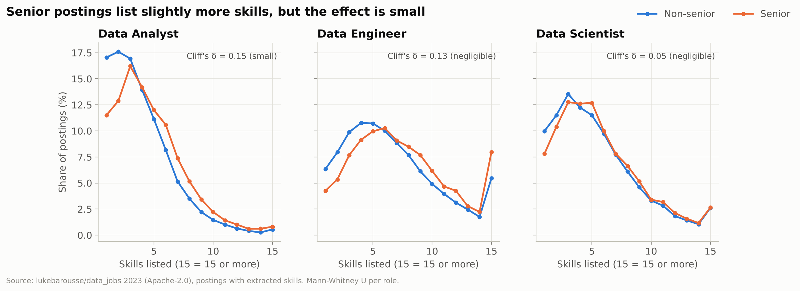
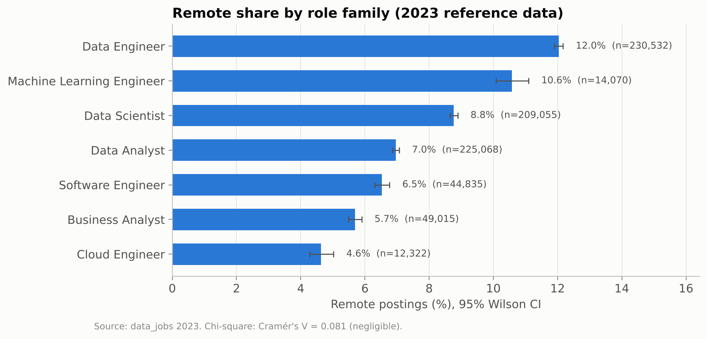
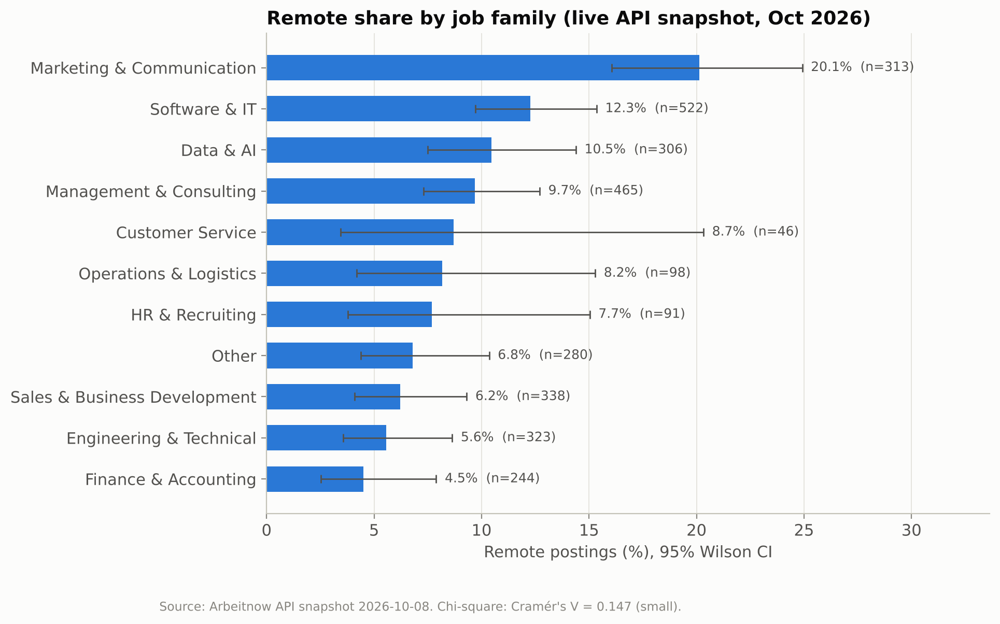
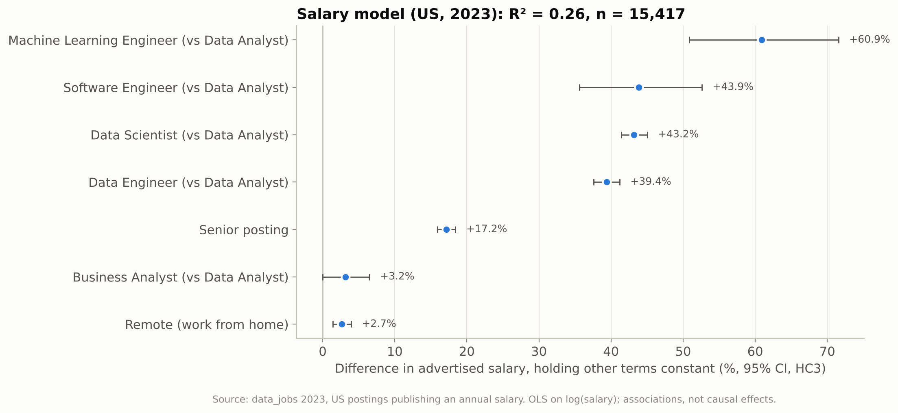
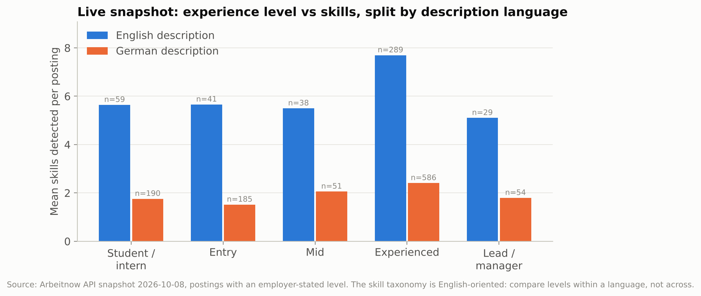
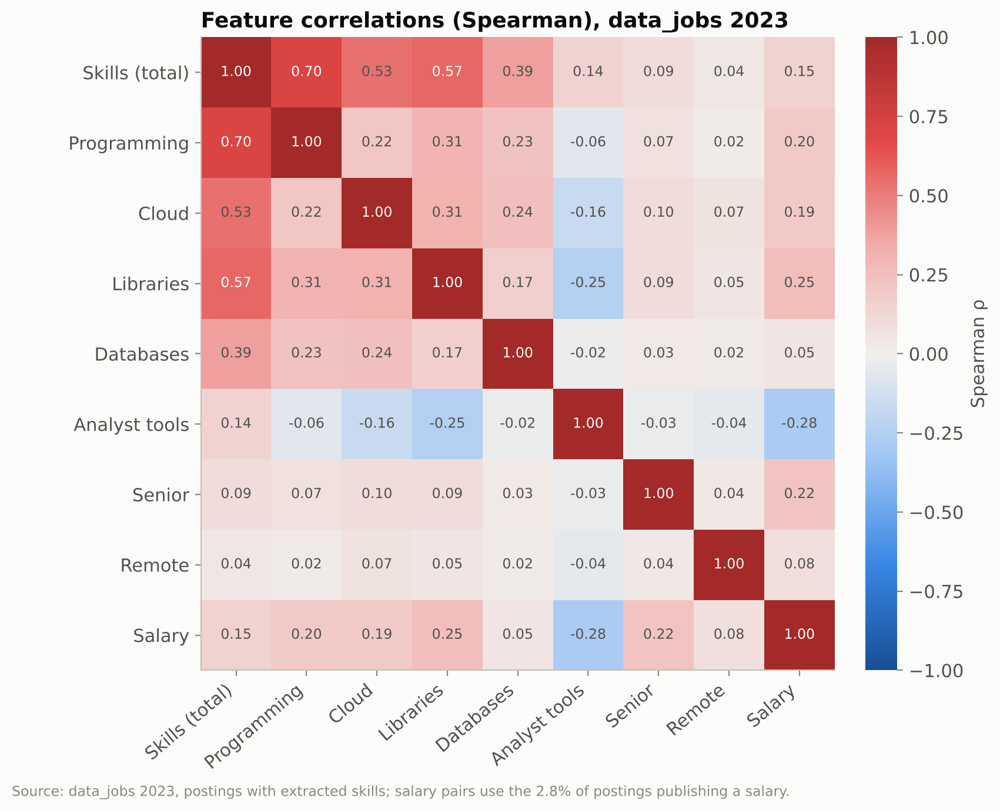

# Statistical Analysis (Phase 4)

**How it was produced:**
- **Data:** read from PostgreSQL with the read-only role (`coach_reader`).
- **Code:** `market/stats/analyses.py` (SciPy + statsmodels).
- **Runner:** `python -m market.stats.run_stats`, which writes every number to `data/processed/stats_results/*.json` and every figure to `reports/figures/stats/` (each with a CSV table view).
- **Notebook:** the executed notebook, with saved outputs, is [`notebooks/statistical_analysis.ipynb`](../notebooks/statistical_analysis.ipynb), rebuilt with `python scripts/build_stats_notebook.py`.
- **Generated:** 2026-10-12.

**Principles:**
1. **Separate sources:**
   - `data_jobs` 2023: 784,897 data-role postings.
   - Arbeitnow snapshot of 2026-10-08: 3,026 postings, all occupations.
   They are analysed separately, never pooled or compared over time.
2. **Effect sizes first.** With up to 785k rows almost every test is "significant"; p-values reported as 0 are below floating-point precision (< 1e-300). Conclusions rely on effect sizes and confidence intervals.
3. **Observational data:** associations, never causal effects.

| # | Question | Test | Result | Effect |
|---|---|---|---|---|
| A | Do senior postings list more skills? | Mann-Whitney U per role, Holm | Rejected H0 in all 3 roles | **Small** (Analyst) / **negligible** (Engineer, Scientist) |
| B | Is remote work associated with the job family? | Chi-square of independence | Rejected H0 in both sources | **Negligible** (2023, V = 0.081) / **small** (2026, V = 0.147) |
| C | Which skills are over-represented in senior postings within the same role? | Cochran-Mantel-Haenszel per skill, BH-FDR | 64 of 71 skills significant | ORs 0.71–1.84 |
| D | What is the advertised salary associated with? | OLS on log(salary), HC3, statsmodels | R² = 0.26 | Senior **+17.2 %**, ML Engineer **+60.9 %** vs Data Analyst |
| E | Do more experienced profiles list more skills? (live) | Kruskal-Wallis + Spearman, stratified by language | Rejected H0 | **Small** (ε² = 0.033); clearer in English (0.089) |

---

## 1. Descriptive statistics

| Variable | n | Mean | SD | Median | Q1–Q3 | Min–Max | Skewness |
|---|---|---|---|---|---|---|---|
| Skills per posting (2023, postings with skill data) | 667,989 | 5.47 | 3.84 | 5 | 3–7 | 1–53 | 1.43 |
| Advertised annual salary (2023, USD as published) | 21,997 | 123,292 | 48,317 | 115,000 | 90,000–150,000 | 15,000–960,000 | 1.75 |
| Skills per posting (live 2026) | 3,026 | 3.67 | 3.69 | 2 | 1–5 | 0–35 | 1.81 |
| Description length in words (live 2026) | 3,026 | 582 | 282 | 528.5 | 386–725 | 9–2,330 | 1.43 |

Every count variable is right-skewed. This motivates rank-based tests for skill counts and a log transformation for salary (skewness 1.75 raw vs −0.12 for log salary in the model sample).

## 2. Question A: Seniority and number of skills (data_jobs 2023)

| | |
|---|---|
| Research question | Do senior postings list more skills than non-senior postings of the same role family? |
| H0 | Within each role family, the distribution of skill counts is identical for senior and non-senior postings |
| H1 | The distributions differ (two-sided) |
| Test | Mann-Whitney U per role family (Data Analyst, Data Engineer, Data Scientist: the roles with a Senior variant); Holm correction across the three tests |
| Why this test | Skill counts are discrete and right-skewed (skewness 0.91–1.53 per group), so the t-test's normality assumption is not plausible. Stratifying by role avoids measuring role differences: the senior share varies between roles |
| Assumptions | Independent postings; ordinal outcome. ✔ |
| Effect size | Cliff's δ (= rank-biserial r); thresholds 0.147 / 0.33 / 0.474 (Romano et al., 2006) |

| Role family | n senior / non-senior | Mean senior vs non-senior | Median | Mean difference (95 % CI) | Holm p | Cliff's δ | P(senior lists more) |
|---|---|---|---|---|---|---|---|
| Data Analyst | 24,852 / 159,228 | 4.70 vs 3.99 | 4 vs 3 | +0.71 (0.67–0.75) | < 1e-300 | **0.153 small** | 0.576 |
| Data Engineer | 41,594 / 169,150 | 7.55 vs 6.70 | 7 vs 6 | +0.86 (0.81–0.90) | < 1e-300 | **0.125 negligible** | 0.563 |
| Data Scientist | 32,060 / 145,669 | 5.74 vs 5.49 | 5 vs 5 | +0.25 (0.21–0.30) | 1.1e-41 | **0.048 negligible** | 0.524 |

**Interpretation:** H0 is rejected for all three roles, but the differences are **small to negligible**. Picking a random senior and a random non-senior Data Engineer posting, the senior one lists more skills only 56 % of the time (50 % would mean no difference). Seniority is not mainly expressed by a longer skill list; Question C looks at *which* skills.

## 3. Question B: Remote work and job family

| | 2023 reference (data roles) | 2026 live snapshot (all occupations) |
|---|---|---|
| H0 / H1 | Remote status independent of role family / not independent | Remote status independent of job family / not independent |
| Test | Pearson chi-square, 7 × 2 table | Pearson chi-square, 11 × 2 table |
| Assumption: expected counts | 0 of 14 cells < 5 (minimum 1,091) ✔ | 1 of 22 cells < 5 (minimum 4.44 for Customer Service) ✔. Cochran's rule (≤ 20 % of cells < 5, none < 1) holds |
| n | 784,897 | 3,026 |
| χ² (df) | 5,122.1 (6) | 65.19 (10) |
| p | < 1e-300 | 3.7e-10 |
| Cramér's V | **0.081, negligible** | **0.147, small** |
| Largest standardized residual (remote) | Data Engineer +51.3 (12.03 % remote) | Marketing & Communication +5.97 (20.13 % remote) |

**Interpretation:**
- **2023 data roles:** remote shares range only from 4.63 % (Cloud Engineer) to 12.03 % (Data Engineer). The association is real but practically negligible.
- **2026 snapshot:** Marketing & Communication postings are clearly more often remote (20.1 %) than Finance & Accounting (4.5 %) or Engineering & Technical (5.6 %).
- The two sources measure different populations with different remote flags, so this is **not** a trend over time.

## 4. Question C: Skills over-represented in senior postings (within role)

| | |
|---|---|
| Research question | Which skills appear disproportionately often in senior postings, **within the same role family**? |
| Data | 572,553 postings with skills in Data Analyst / Engineer / Scientist; the 71 skills present in ≥ 5,000 of them |
| H0 (per skill) | The odds of mentioning the skill are the same for senior and non-senior postings (common odds ratio = 1 across the three role strata) |
| H1 | Common odds ratio ≠ 1 |
| Test | Cochran-Mantel-Haenszel test, stratified by role family. A plain 2 × 2 test would confuse "senior" with "more often a Data Engineer". 71 tests, so Benjamini-Hochberg false-discovery rate at 5 % |
| Assumptions | Independent postings; large stratum counts (≥ 5,000 postings with the skill). Breslow-Day homogeneity test reported for each skill |
| Effect size | Mantel-Haenszel pooled odds ratio with 95 % CI |

**Result:**
- 64 of 71 skills are significant at 5 % FDR: 47 more frequent in senior postings, 17 less frequent.
- Not significant: Confluence, SSRS, Windows, DAX, Data Visualization, CI/CD, PowerShell.

| Skill | Senior share | Non-senior share | MH odds ratio (95 % CI) |
|---|---|---|---|
| Looker | 4.84 % | 2.83 % | **1.84** (1.78–1.91) |
| Redshift | 8.53 % | 4.86 % | **1.65** (1.61–1.70) |
| Snowflake | 13.16 % | 8.12 % | **1.59** (1.56–1.62) |
| Airflow | 10.84 % | 6.62 % | **1.54** (1.50–1.57) |
| Terraform | 3.94 % | 2.33 % | **1.49** (1.44–1.55) |
| AWS | 29.32 % | 20.51 % | **1.47** (1.44–1.49) |
| Kafka | 10.94 % | 7.13 % | **1.41** (1.38–1.45) |
| Kubernetes | 6.50 % | 4.24 % | **1.38** (1.34–1.42) |
| … | | | |
| JavaScript | 2.67 % | 3.30 % | **0.79** (0.76–0.83) |
| C++ | 2.41 % | 3.00 % | **0.75** (0.72–0.78) |
| Excel | 13.22 % | 19.58 % | **0.73** (0.71–0.75) |
| MATLAB | 1.46 % | 2.03 % | **0.71** (0.67–0.75) |
| VBA | 1.24 % | 2.06 % | **0.71** (0.66–0.75) |

**Interpretation:**
- Within the same role, senior postings ask more often for **data-platform and cloud infrastructure tools**: warehouses (Redshift, Snowflake, BigQuery), orchestration (Airflow), streaming (Kafka), infrastructure (AWS, Terraform, Kubernetes) and BI platforms (Looker).
- Non-senior postings ask more often for **desktop and academic tools** (Excel, VBA, MATLAB).
- For 65 of 71 skills the Breslow-Day test indicates that the strength of the association differs between the three roles. The pooled odds ratio is therefore an average; the per-role shares in the SQL results (`04_reference_senior_skill_lift.csv`) give the detail.

This is the statistical basis for the coach's message: "senior data roles emphasise cloud and data-platform tools".

## 5. Question D: Salary model (statsmodels)

| | |
|---|---|
| Research question | Which posting characteristics are associated with the advertised annual salary? |
| Data | US postings with an annual salary and extracted skills, **n = 15,417**. One country only, so currency and national pay levels don't mix with role. Cloud Engineer excluded (19 salaries < 100) |
| Model | `log(salary) ~ role family (ref. Data Analyst) + senior + remote + skill count`, OLS with **HC3 robust standard errors** |
| H0 (per coefficient) | Coefficient = 0, holding the other terms constant |
| Assumptions | log salary skewness −0.12 ✔ · residual skewness 0.06, excess kurtosis 1.12 (heavier tails; inference relies on n = 15,417) · **Breusch-Pagan p = 1.1e-53: heteroscedasticity, hence HC3** · max VIF 1.54 (no multicollinearity) ✔ |
| Fit | R² = 0.261, adjusted R² = 0.261, F-test p < 1e-300 |

| Term | Difference in advertised salary | 95 % CI | p |
|---|---|---|---|
| Machine Learning Engineer (vs Data Analyst) | **+60.9 %** | 50.9 to 71.6 % | 2.2e-47 |
| Software Engineer | +43.9 % | 35.6 to 52.6 % | 2.2e-33 |
| Data Scientist | +43.2 % | 41.4 to 45.0 % | < 1e-300 |
| Data Engineer | +39.4 % | 37.6 to 41.2 % | < 1e-300 |
| **Senior posting** | **+17.2 %** | 15.9 to 18.4 % | 1.0e-180 |
| Remote (work from home) | +2.7 % | 1.4 to 3.9 % | 3.3e-05 |
| Each additional listed skill | +0.29 % | 0.16 to 0.43 % | 1.7e-05 |
| Business Analyst | +3.2 % | −0.0 to 6.5 % | 0.052 (not significant) |

(% effect = exp(coefficient) − 1.)

**Interpretation:**
- **Role family is the strongest correlate** of advertised pay.
- **Seniority:** holding role, remote and skill count constant, senior postings advertise about 17 % more.
- **Skill count:** associated with pay, but tiny per skill. *Which* skills matters more than how many (see the correlations in §7).
- **What the model misses:** it explains a quarter of the variance; company, city and the candidate's actual experience are not in the data.
- **Selection:** only 2.8 % of postings publish a salary, possibly a non-random subset.

## 6. Question E: Experience level and skills (live snapshot 2026)

| | |
|---|---|
| Research question | Do postings for more experienced profiles list more skills? |
| Data | 1,616 Arbeitnow postings with an employer-stated experience level |
| H0 / H1 | Skill-count distributions are identical across the 5 levels / at least one differs; monotonic association with level order (Spearman) |
| Test | Kruskal-Wallis H + Spearman ρ, overall **and within description language** |
| Why stratify | The skill taxonomy is English-oriented and the share of English descriptions rises with level (entry 17.6 %, experienced 31.7 %, lead/manager 33.3 %). Language is a confounder of the measured skill count |
| Effect size | ε² for Kruskal-Wallis (≈ 0.01 small, 0.08 medium, 0.26 large) |

| Subset | n | Mean skills: student / entry / mid / experienced / lead | H | p | ε² | Spearman ρ (p) |
|---|---|---|---|---|---|---|
| All languages | 1,616 | 2.68 / 2.26 / 2.78 / **4.03** / 2.90 | 53.39 | 7.1e-11 | **0.033** | 0.133 (8.1e-08) |
| English descriptions | 456 | 5.64 / 5.66 / 5.50 / **7.70** / 5.10 | 40.42 | 3.5e-08 | **0.089** | 0.159 (6.5e-04) |
| German descriptions | 1,066 | 1.76 / 1.52 / 2.06 / **2.41** / 1.80 | 11.20 | 0.024 | **0.011** | 0.067 (0.029) |

**Interpretation:**
- "Experienced" postings list the most skills, but the relationship is **not monotonic**: lead/manager postings list fewer, consistent with more managerial, less tool-focused descriptions.
- The effect is small overall, medium-sized among English descriptions, and nearly absent among German ones. This is what the measurement limitation predicts.
- The sample is small, so this is supporting evidence only.

## 7. Feature correlations (Spearman, data_jobs 2023)

- **Total skills** correlates with its components by construction: programming ρ = 0.70, libraries 0.57, cloud 0.53.
- **Salary** (2.8 % subset) correlates most with library skills (0.25), seniority (0.22), programming (0.20) and cloud (0.19), and **negatively with analyst tools (−0.28)**: Excel/Power BI-type tools are typical of lower-paid analyst roles. Remote work barely correlates with anything (|ρ| ≤ 0.08).
- These are pairwise associations; the regression in §5 holds role and seniority constant.

## 8. What this means for the product

| Finding | Use in the AI Interview Coach |
|---|---|
| Skill *types*, not skill *counts*, distinguish senior postings (A vs C) | The coach highlights which skills a role asks for; it does not reward long skill lists |
| Cloud/data-platform tools are over-represented in senior roles (C) | Gap explanations can say *"AWS is in 29 % of senior vs 21 % of non-senior data postings in the 2023 dataset"* |
| Role family and seniority are the main salary correlates (D) | Market context: which roles a profile is closest to (Phase 6 ML model) |
| Description language biases skill detection (E) | Documented limitation of the coach's English-oriented taxonomy |

## 9. Limitations

- **Observational data:** no causal interpretation (e.g. learning Looker does not "cause" seniority).
- **Reference data:**
  - 2023 only, data roles only;
  - collected from Google Jobs searches (the country mix follows the collector);
  - the seniority label is derived from job titles;
  - skills were keyword-extracted by the dataset author.
- **Salary:** advertised, not actual pay; 2.8 % of postings; 77 % of salaries are US, so the model is US-only.
- **Live data:** one week, Germany-centred, rule-based labels, and English-oriented skill detection (§6).
- **Multiple testing:** Holm (A) and Benjamini-Hochberg (C) are applied. Across the whole document more tests were run than are corrected for, so isolated borderline p-values (e.g. 0.024–0.052) should be read cautiously.
- **Large n:** tiny p-values do not mean large or important effects; read Cliff's δ, Cramér's V, odds ratios, ε² and confidence intervals.
